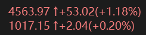

<!-- 语言切换链接 -->
<p align="center">
  <a href="#中文">中文</a> | 
  <a href="#english">English</a>
</p>

---

<a id="中文"></a>
## 📈 黄金价格插件 for TrafficMonitor

为 [TrafficMonitor](https://github.com/zhongyang219/TrafficMonitor) 开发的插件，在任务栏显示**伦敦金**和**浙商银行积存金**价格，涨跌自动变色（红涨绿跌）。两路行情由独立后台任务获取，分别更新，慢请求不会阻塞另一项显示。

### ✨ 功能特点
- 伦敦金价格（美元/盎司） + 涨跌额 + 涨跌幅  
- 浙商金价格（元/克） + 涨跌额 + 涨跌幅  
- 显示格式：`当前价 ↑/↓涨跌额(涨跌幅)`  
- 颜色：红涨绿跌（深色模式下柔和配色）  
- 自动跟随 TrafficMonitor 字体和主题  
- 使用 Windows 原生 WinINet；JSON 解析使用随源码附带的 nlohmann/json 3.12.0，无额外运行库安装要求

### 📸 效果预览
<p align="center">
  
</p>

### 📥 安装
1. 从 [Releases](../../releases) 下载 `GoldPricePlugin.dll`  
2. 将 DLL 放入 TrafficMonitor 安装目录下的 `plugins` 文件夹（若不存在则新建）  
3. 重启 TrafficMonitor  
4. 右键任务栏图标 → **其他功能** → **插件管理**，确认插件已加载  
5. 在 **显示项目** 中勾选 **London Gold** 和 **ZheShang Gold**

### 🔧 自行编译
- 需要 Visual Studio 2022（含 C++ 桌面开发）  
- 打开 `GoldPricePlugin.sln`，选择 **Release** 和 **x64**（或与你的 TrafficMonitor 相同架构）  
- 生成 → 生成解决方案  
- 生成的 `GoldPricePlugin.dll` 位于 `x64\Release\`

### ☁️ GitHub 编译
在 **Actions → Build DLL → Run workflow** 中填写版本号工具计算的 `version` 和 `build`。工作流分别构建 x64、Win32 Release DLL，运行解析、独立请求和卸载测试，再上传对应的 Artifacts。

下载与 TrafficMonitor 架构一致的产物，解压后使用其中的 `GoldPricePlugin.dll`；`build-info.json` 记录构建标签、提交和 DLL 的 SHA-256。构建标签不改写插件内部版本，当前插件管理界面仍显示 `0.0.1`。

### 📊 数据来源
- **伦敦金**：京东金融黄金行情，品种 `WG-XAUUSD`（美元/盎司）
- **浙商金**：京东黄金

### ⚠️ 注意事项
- 如果价格不显示，请检查网络连接和防火墙是否允许 TrafficMonitor 联网  
- 每次 TrafficMonitor 调用 `DataRequired` 时分别检查两路任务；每路启动间隔至少 1 秒，同一路最多一个在途请求。实际频率取决于宿主回调频率、网络耗时及上游行情更新频率
- 请求或数据校验失败时保留上一次有效报价；初次获取成功前显示初始值。界面不另行标注旧报价
- WinINet 的连接、发送、接收阶段超时各为 3 秒，并对读取耗时及响应大小设限；这不是整个请求严格 3 秒的总超时
- 京东接口来自页面使用的行情服务，未找到面向第三方的长期免费或可用性承诺
- 深色模式下红绿颜色会略微调柔，保证可读性

### 🙏 致谢
本插件由 [DeepSeek](https://deepseek.com) 辅助创建。

### 📄 开源协议
MIT License

---

<a id="english"></a>
## 📈 Gold Price Plugin for TrafficMonitor

A plugin for [TrafficMonitor](https://github.com/zhongyang219/TrafficMonitor) that displays **London Gold** and **ZheShang Gold** prices on the taskbar. Prices include change amount and percentage, color-coded red for up and green for down. Each source has an independent background request and publishes its quote without waiting for the other source.

### ✨ Features
- London Gold price (USD/oz) + change amount + change percentage  
- ZheShang Gold price (CNY/g) + change amount + change percentage  
- Format: `current price ↑/↓change amount(change percentage)`  
- Colors: red for increase, green for decrease (softer in dark mode)  
- Follows TrafficMonitor’s font and theme  
- Uses native Windows WinINet and bundled nlohmann/json 3.12.0; no additional runtime installation is required

### 📸 Screenshot
<p align="center">
  
</p>

### 📥 Installation
1. Download `GoldPricePlugin.dll` from [Releases](../../releases)  
2. Place it into the `plugins` folder inside your TrafficMonitor installation directory (create if not exists)  
3. Restart TrafficMonitor  
4. Right-click the tray icon → **Other Features** → **Plugin Manager**, confirm the plugin is loaded  
5. Go to **Display Items** and check **London Gold** and **ZheShang Gold**

### 🔧 Build from Source
- Requires Visual Studio 2022 (with “Desktop development with C++”)  
- Open `GoldPricePlugin.sln`, set configuration to **Release**, platform to **x64** (or match your TrafficMonitor)  
- Build → Build Solution  
- The resulting `GoldPricePlugin.dll` is in `x64\Release\`

### ☁️ GitHub Build
Open **Actions → Build DLL → Run workflow** and enter the `version` and `build` calculated by update-version. The workflow builds and tests x64 and Win32 Release DLLs and uploads separate artifacts. Choose the architecture matching TrafficMonitor and extract `GoldPricePlugin.dll`.

`build-info.json` records the package label, source commit and DLL SHA-256. Package labels do not change the plugin's internal version, which currently remains `0.0.1`.

### 📊 Data Sources
- **London Gold**: JD Finance gold quotes, symbol `WG-XAUUSD` (USD/troy ounce)
- **ZheShang Gold**: JD.com Gold

### ⚠️ Notes
- If prices do not appear, check your internet connection and firewall permissions for TrafficMonitor  
- Each TrafficMonitor `DataRequired` callback checks both sources independently. A source starts at most once per second and has at most one request in flight. Actual cadence depends on host callbacks, request duration and upstream updates
- Failed requests or invalid data keep the last good quote. Initial values remain until the first success; stale values are not separately marked in the UI
- Connection, send and receive timeouts are 3 seconds each, with additional response-read duration and size limits. This is not a strict 3-second end-to-end timeout
- These JD endpoints are used by public pages; no long-term third-party availability or free-access commitment has been established
- In dark mode, colors are slightly softened for better readability

### Verification

Build the DLL in a fresh directory (existing CMake caches may contain an old source path):

```powershell
cmake -S . -B build/jd-verify -G "Visual Studio 17 2022" -A x64
cmake --build build/jd-verify --config Release
cmake -S tests -B build/jd-verify-tests -G "Visual Studio 17 2022" -A x64
cmake --build build/jd-verify-tests --config Release
ctest --test-dir build/jd-verify-tests -C Release --output-on-failure
build/jd-verify-tests/Release/gold_source_tests.exe --live 300 build/jd-verify-tests/live.jsonl
```

The native live sampler uses the same WinINet requests and quote parsers as the plugin, polls both sources independently, and records success/failure, request latency, price changes and source timestamp age. London's zone-less timestamp is interpreted as UTC+08:00 for diagnostics; source clock differences affect the measured age. Automated tests also cover malformed responses, independent scheduling and DLL unloading during in-flight requests. These checks do not replace testing the DLL inside TrafficMonitor.

### 🙏 Acknowledgement
This plugin was created with the assistance of [DeepSeek](https://deepseek.com).

### 📄 License
MIT License
